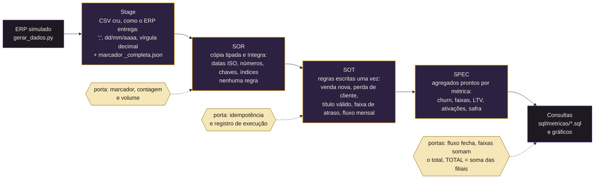

# ISP Analytics — versão portfólio

[](https://github.com/vertonds/isp-analytics/actions/workflows/pipeline.yml)


[](LICENSE)

## Resumo em 30 segundos

Pipeline analítico de um provedor de internet, com dados sintéticos, organizado em camadas **Stage → SOR → SOT → SPEC**
em SQLite. Cada métrica tem **uma definição só, escrita uma vez em SQL e conferida a cada carga** por portas de
qualidade que bloqueiam número errado. Projeto de portfólio de [Everton Vieira](https://vertonds.github.io).

| **1,3% ao mês** | **R$ 443.842** | **6 portas + 9 testes** |
|:---:|:---:|:---:|
| churn consolidado nos últimos 12 meses, com a base crescendo de 4.678 para 6.195 contratos ativos | vencido em aberto na data de referência; 60% há mais de 180 dias, quase tudo em contratos já cancelados | rodam a cada carga e no CI; agregado tem de bater com o detalhe, senão a carga não passa |

<picture>
  <source media="(prefers-color-scheme: dark)" srcset="docs/imagens/churn_mensal-escuro.png">
  
</picture>

**Índice:** [O problema](#1-o-problema) · [Arquitetura](#2-arquitetura) · [Como rodar](#3-como-rodar) ·
[Modelo de dados](#4-modelo-de-dados) · [Decisões](#5-decisões-de-projeto) · [As métricas](#6-as-métricas) ·
[Portas e testes](#7-portas-de-qualidade-e-testes) · [Limitações](#8-limitações-e-próximos-passos) · [Sobre](#9-sobre)
· [Resultados completos](docs/RESULTADOS.md)

> **Todo dado aqui é sintético** (NumPy + Faker, semente fixa). A arquitetura e as regras vêm de um dashboard real que
> construí para um provedor regional; nenhum dado da empresa está neste repositório.

| | |
|---|---|
| **Stack** | Python 3.12+ (CI em 3.12 e 3.14) · NumPy · pandas · Faker · SQLite 3.50 · matplotlib |
| **Volume** | 7.920 clientes · 9.000 contratos · 186.726 faturas · 18.627 ordens de serviço · 33 meses de série |
| **Tempo** | pipeline inteiro em ~15 s (geração 7,6 s · carga 3,7 s · SOT 1,5 s · SPEC 0,3 s · portas 0,1 s) |
| **Resultados** | [`docs/RESULTADOS.md`](docs/RESULTADOS.md) (tabelas geradas) · [`docs/imagens/`](docs/imagens/) (gráficos) |

---

## 1. O problema

Um provedor de internet vive de três números: quantos clientes entram, quantos saem e quem está pagando. O ERP tem
tudo isso — e é exatamente por isso que cada setor chega a um número diferente:

- **Churn** muda conforme quem conta: a troca de titularidade (o contrato muda de nome, o cliente continua) entra como
  cancelamento numa tela e não entra na outra.
- **Inadimplência** sai errada quando alguém soma a tabela de faturas sem olhar o status: existem faturas
  **canceladas com valor negativo**. Nesta base, somar tudo dá R$ 28.011.848; somar só o que vale dá R$ 27.810.786.
  Diferença de R$ 201 mil que ninguém explica em reunião.
- **Competência** por data de emissão desloca o atraso para o mês errado.
- **LTV** calculado como `ticket × 1/churn` explode quando o churn é pequeno: um plano com 0,27% ao mês ganha
  "vida esperada" de 374 meses.

O objetivo do projeto é mostrar como se organiza o dado para que **cada métrica tenha uma definição só, escrita uma
vez, conferida a cada carga** — e como se prova isso.

## 2. Arquitetura



As portas rodam no fim de cada etapa e **bloqueiam** a seguinte se falharem; Python orquestra e carrega, e as camadas
SOT e SPEC são só SQL.

| Camada | O que é | O que **não** entra | Onde está |
|---|---|---|---|
| **Stage** | a extração como veio, sem tratar | nenhuma conversão | `data/stage/<tabela>/` |
| **SOR** (System of Record) | cópia tipada, com chaves e índices | regra de negócio | `sql/01_stage_sor/ddl.sql` + `src/carregar_sor.py` |
| **SOT** (Source of Truth) | o contrato, o título e o mês com as regras aplicadas | agregação | `sql/02_sor_sot/*.sql` |
| **SPEC** (específico de consumo) | tabelas prontas por métrica | regra nova | `sql/03_sot_spec/*.sql` |
| Consultas | perguntas de negócio sobre o SPEC/SOT | — | `sql/metricas/*.sql` |

Tudo mora num único arquivo SQLite (`data/warehouse/isp_analytics.db`), com o prefixo da tabela dizendo a camada
(`sor_`, `sot_`, `spec_`). O Python orquestra e carrega; **as camadas SOT e SPEC são só SQL**.

## 3. Como rodar

```powershell
git clone https://github.com/vertonds/isp-analytics.git
cd isp-analytics
.\rodar.ps1            # Windows: cria o .venv, instala as dependências, roda o pipeline e os testes
./rodar.sh             # Linux / macOS: o mesmo
```

O mesmo roteiro roda a cada push no GitHub Actions (`.github/workflows/pipeline.yml`): o selo no topo é a
prova de que o projeto sobe do zero, num ambiente limpo, com as versões fixadas em `requirements.txt`.

Ou passo a passo:

```powershell
python -m venv .venv ; .\.venv\Scripts\python -m pip install -r requirements.txt
.\.venv\Scripts\python -m src.pipeline                      # Stage → SOR → SOT → SPEC → portas → relatório
.\.venv\Scripts\python -m src.consultar churn               # qualquer arquivo de sql/metricas/ (--md para Markdown)
.\.venv\Scripts\python -m unittest -v                       # portas + idempotência
```

Saída do pipeline:

```
[   7.4s] stage (gerar): {'filial': 5, 'plano': 6, 'cliente': 7920, 'contrato': 9000, 'fatura': 186726, 'ordem_servico': 18627}
[   4.6s] sor: {'filial': 5, 'plano': 6, 'cliente': 7920, 'contrato': 9000, 'fatura': 186726, 'ordem_servico': 18627}
[   2.0s] sot: ['10_sot_contrato.sql', '20_sot_titulo.sql', '30_sot_calendario_mes.sql', '40_sot_base_mensal.sql']
[   0.3s] spec: ['10_spec_churn_mensal.sql', '20_spec_inadimplencia_faixa.sql', '30_spec_ltv_plano.sql', '40_spec_ativacoes_filial_mes.sql', '50_spec_safra_retencao.sql']
[   0.0s] portas: {'stage_igual_sor': {'filial': 5, 'plano': 6, 'cliente': 7920, 'contrato': 9000, 'fatura': 186726, 'ordem_servico': 18627}, 'nenhum_titulo_cancelado_no_sot': 183041, 'fluxo_da_base_fecha': 165, 'faixas_somam_o_total': 443841.63, 'churn_total_e_soma_das_filiais': 33, 'ativacoes_batem_com_a_base': 5200}
[   2.2s] relatorio: {'churn': 'churn_mensal', 'inadimplencia': 'inadimplencia_faixas', 'ltv': 'ltv_plano', 'ativacoes': 'ativacoes_filial', 'safra': 'safra_retencao'}
pipeline concluído — portas OK, relatório em docs/
```

```
isp-analytics/
├── src/
│   ├── config.py           parâmetros (datas, volumes, pesos) — um lugar só
│   ├── gerar_dados.py      Stage: a base fictícia
│   ├── carregar_sor.py     Stage → SOR (marcador, contagem, volume, transação única)
│   ├── camadas.py          roda os SQL do SOT e do SPEC em ordem
│   ├── portas.py           invariantes que bloqueiam
│   ├── controle.py         registro de toda execução
│   ├── relatorio.py        gráficos e docs/RESULTADOS.md
│   ├── consultar.py        roda uma consulta de sql/metricas/
│   └── pipeline.py         orquestra tudo
├── sql/
│   ├── 01_stage_sor/       DDL do SOR
│   ├── 02_sor_sot/         regras de negócio
│   ├── 03_sot_spec/        agregados por métrica
│   └── metricas/           as perguntas de negócio (churn, inadimplência, LTV, ativações, safra, O.S.)
├── tests/                  as mesmas portas + idempotência
├── data/                   stage/ (CSV gerado) · warehouse/ (SQLite, ignorado pelo git)
├── docs/                   RESULTADOS.md · imagens/
├── .github/workflows/      CI: pipeline + testes em Python 3.12 e 3.14
└── rodar.ps1 · rodar.sh    o roteiro completo em um comando (Windows · Linux/macOS)
```

## 4. Modelo de dados

```
sor_filial (5) ──┬── sor_cliente (7.920) ── sor_contrato (9.000) ──┬── sor_fatura (186.726)
                 │                               │                 └── sor_ordem_servico (18.627)
sor_plano (6) ───┴───────────────────────────────┘
```

- **contrato**: ativação, cancelamento, motivo de inclusão (`VENDA`, `TROCA DE TITULARIDADE`, `MIGRACAO DE PLANO`),
  motivo de cancelamento, valor, status do ERP (`A`/`D`).
- **fatura**: competência, vencimento, valor, pagamento, status `A` (aberta) / `R` (recebida) / `C` (cancelada).
- **ordem de serviço**: assunto (`INSTALACAO`, `REPARO`, `MUDANCA DE ENDERECO`, `CANCELAMENTO`), abertura, fechamento.
- **cliente**: só o **hash** do CPF/CNPJ persiste (`documento_hash`); o documento em si nunca chega ao banco.

A base fictícia tem comportamento, não só linhas: o risco mensal de cancelar depende de filial, plano e **idade do
contrato** (alto nos 3 primeiros meses, baixo depois de 12); quem cancela por dificuldade financeira deixa as três
últimas faturas em aberto; atraso curto e longo têm propensões por contrato; e 2% das faturas são canceladas, um
terço delas com valor negativo — a armadilha existe de propósito.

## 5. Decisões de projeto

1. **Stage é cru, SOR é tipado, e só isso.** A conversão de `dd/mm/aaaa` e vírgula decimal acontece uma vez, na
   carga. Nenhuma regra de negócio entra no SOR — se entrasse, dois leitores poderiam aplicar regras diferentes.
2. **Partição sem marcador não entra.** A extração grava `_completa.json` só em caso de sucesso; a carga confere o
   marcador e a contagem. Extração pela metade nunca vira "queda de clientes".
3. **Porta de volume.** Tabela com ≥ 200 linhas que cai mais de 50% bloqueia a carga. A resposta a um bloqueio é
   recoletar, nunca contornar.
4. **Carga idempotente e atômica.** Leio e valido todas as partições, depois troco tudo numa transação só
   (filhos → pais no `DELETE`, pais → filhos no `INSERT`, chave estrangeira ligada). Rodar duas vezes dá o mesmo
   banco — o teste `Idempotencia` prova.
5. **Toda métrica financeira declara coluna de valor e filtro de status.** `sot_titulo` só tem `A` e `R`; o `C` fica
   no SOR para diagnóstico. A porta `nenhum_titulo_cancelado_no_sot` garante.
6. **Competência é o vencimento, nunca a emissão.** Atraso conta do vencimento até a data de referência.
7. **Troca de titularidade não é perda.** O contrato sai, o cliente fica. `perda_cliente` é a coluna que todo churn
   lê; nesta base são 235 saídas que **não** são perda, de 2.805 saídas no total.
8. **O saldo da base tem uma conta só.** `sot_base_mensal` calcula ativos no início, entradas, saídas e ativos no fim
   por mês e filial; a porta `fluxo_da_base_fecha` exige `fim = início + entradas − saídas` em todas as 165 linhas e
   que o fim de um mês seja o início do seguinte.
9. **"Hoje" é um parâmetro, não o relógio.** `DATA_REFERENCIA` (30/09/2026, último dia fechado) entra nos SQL como
   `__REF__`. O resultado é reprodutível em qualquer data.
10. **Agregado = detalhe, sempre conferido.** O TOTAL do churn é a soma das filiais; as faixas de atraso somam o
    total vencido; as ativações do SPEC são as vendas novas do SOT. São portas, rodam a cada carga, bloqueiam.
11. **LTV com horizonte.** `1/churn` dá 374 meses para o plano dedicado; o SPEC entrega também `ltv_esperado_60m`
    (vida limitada a 5 anos) e o `ltv_realizado` (receita média de quem já saiu). Os três ficam lado a lado porque
    nenhum é "o" LTV — e o realizado tem viés conhecido: só vê quem saiu.
12. **Toda execução fica registrada** (`controle_execucao`: etapa, início, fim, duração, OK/FALHA, detalhe). Carga
    sem registro não existe.
13. **SQL em arquivo, em ordem, com parâmetro.** O Python não monta SQL por string; cada arquivo começa com o
    comentário que diz o que a tabela é e qual regra aplica.

## 6. As métricas

Cada métrica declara **o que conta, a coluna de valor, o filtro de status e a data que recorta**. O SQL completo está
em `sql/`; abaixo, o trecho que carrega a regra e o que o resultado mostra.

### Churn mensal por filial

`perdas de cliente no mês ÷ contratos ativos no início do mês`, por filial e consolidado. Perda = saída cujo motivo
não é troca de titularidade.

```sql
-- sql/03_sot_spec/10_spec_churn_mensal.sql
SELECT mes, id_filial, filial, ativos_inicio, perdas,
       ROUND(100.0 * perdas / NULLIF(ativos_inicio, 0), 2) AS churn_pct
FROM sot_base_mensal
UNION ALL
SELECT mes, 0, 'TOTAL', SUM(ativos_inicio), SUM(perdas),
       ROUND(100.0 * SUM(perdas) / NULLIF(SUM(ativos_inicio), 0), 2)
FROM sot_base_mensal GROUP BY mes;
```

<picture>
  <source media="(prefers-color-scheme: dark)" srcset="docs/imagens/churn_mensal-escuro.png">
  
</picture>

Leitura: churn consolidado em torno de **1,3% ao mês** nos últimos 12 meses (≈ 15% ao ano), com a base crescendo de
2.415 para 6.195 contratos ativos ao longo dos 33 meses da série (4.678 no início dos últimos 12). As filiais menores oscilam mais: nos 24 meses do gráfico, o desvio padrão do churn
mensal é 0,63 ponto na Filial Oeste (542 contratos ativos em média), 0,44 na Leste (728) e 0,43 na Norte (829), contra
0,26 na Centro (1.640). O gráfico mostra o ruído, e `sql/metricas/churn.sql` adiciona a média móvel de 3 meses para quem
precisa de tendência.

### Inadimplência por faixa de atraso

Títulos com status `A` e vencimento anterior à data de referência, agrupados em `01-30`, `31-60`, `61-90`, `91-180`
e `181+` dias. Coluna de valor: valor do título.

```sql
-- sql/02_sor_sot/20_sot_titulo.sql (a regra)
CASE WHEN f.status <> 'A' OR f.data_vencimento >= '__REF__' THEN NULL
     WHEN julianday('__REF__') - julianday(f.data_vencimento) <= 30  THEN '01-30'
     WHEN julianday('__REF__') - julianday(f.data_vencimento) <= 60  THEN '31-60'
     WHEN julianday('__REF__') - julianday(f.data_vencimento) <= 90  THEN '61-90'
     WHEN julianday('__REF__') - julianday(f.data_vencimento) <= 180 THEN '91-180'
     ELSE '181+' END AS faixa_atraso
...
WHERE f.status IN ('A', 'R');   -- 'C' nunca alimenta indicador
```

<picture>
  <source media="(prefers-color-scheme: dark)" srcset="docs/imagens/inadimplencia_faixas-escuro.png">
  
</picture>

| faixa | títulos | contratos | valor vencido | % |
|---|---|---|---|---|
| 01-30 | 446 | 446 | R$ 68.746 | 15,5% |
| 31-60 | 217 | 217 | R$ 32.912 | 7,4% |
| 61-90 | 179 | 179 | R$ 28.543 | 6,4% |
| 91-180 | 359 | 290 | R$ 48.509 | 10,9% |
| 181+ | 2.113 | 860 | R$ 265.132 | 59,7% |
| **total** | **3.314** | **1.992** | **R$ 443.842** | 100% |

> **Nota:** o total de contratos soma as faixas; um contrato com títulos em mais de uma faixa conta em cada uma.
> Contratos distintos com vencido: 1.776. Corrigir o TOTAL no SQL para contar distintos, com teste, é um próximo passo.

Leitura: 60% do valor vencido tem mais de 180 dias — e a maior parte está em contratos **já cancelados** (quem saiu
por dificuldade financeira deixou as últimas faturas). Entre os contratos **ativos**, 941 de 6.195 (15,2%) têm algum
título vencido; `sql/metricas/inadimplencia_filial.sql` faz esse recorte por filial, com a parcela acima de 90 dias.

### LTV por plano

```sql
-- sql/03_sot_spec/30_spec_ltv_plano.sql (resumo)
ticket_medio        = AVG(valor) dos títulos RECEBIDOS nos últimos 12 meses, por plano
churn_mensal        = perdas ÷ exposição (ativos no início de cada um dos 12 meses)
ltv_esperado        = ticket_medio × (1 ÷ churn_mensal)
ltv_esperado_60m    = ticket_medio × MIN(60, 1 ÷ churn_mensal)
ltv_realizado       = AVG(receita recebida) dos contratos que já saíram como perda
```

<picture>
  <source media="(prefers-color-scheme: dark)" srcset="docs/imagens/ltv_plano-escuro.png">
  
</picture>

Leitura: o plano dedicado vale dez vezes um plano residencial de entrada — e é também onde o `1/churn` sem
horizonte mais engana (R$ 330 mil "esperados"). Em cada plano o realizado fica entre 23% e 27% do esperado, porque
só enxerga quem já saiu, com 14,6 meses de casa em média; quem fica mais tempo ainda não entrou na conta. O projeto
entrega os três e documenta o viés em vez de escolher o número mais bonito.

### Ativações por filial

Vendas novas (motivo de inclusão `VENDA`) por filial e mês, com variação contra o mês anterior e contra o mesmo mês
do ano anterior (funções de janela) e a fatia de cada filial no mês.

```sql
-- sql/03_sot_spec/40_spec_ativacoes_filial_mes.sql
SELECT mes, id_filial, filial, vendas_novas AS ativacoes,
       LAG(vendas_novas, 1)  OVER (PARTITION BY id_filial ORDER BY mes) AS mes_anterior,
       LAG(vendas_novas, 12) OVER (PARTITION BY id_filial ORDER BY mes) AS mesmo_mes_ano_anterior,
       ROUND(100.0 * vendas_novas / NULLIF(SUM(vendas_novas) OVER (PARTITION BY mes), 0), 1) AS fatia_pct
FROM sot_base_mensal;
```

<picture>
  <source media="(prefers-color-scheme: dark)" srcset="docs/imagens/ativacoes_filial-escuro.png">
  
</picture>

Leitura: 5.200 vendas novas nos 33 meses da série (3.187 nos 18 meses do gráfico; 2.168 nos 12 meses da tabela);
Filial Centro responde por ~34% delas em qualquer um dos três recortes. A série sai do calendário do SOT, por
isso mês sem venda apareceria com zero, não sumiria.

### Safra de vendas (retenção por coorte)

De cada mês de venda, quantos continuam após 3, 6 e 12 meses — contando **só quem já tem a idade**: coorte jovem
fica `NULL`, não zero.

<picture>
  <source media="(prefers-color-scheme: dark)" srcset="docs/imagens/safra_retencao-escuro.png">
  
</picture>

Leitura: ~93% das vendas passam de 3 meses, ~88% de 6 e ~80% de 12. Essa curva é o que calibra o risco de
cancelamento por idade e o que diz se uma safra recente está pior do que as antigas.

### Ordens de serviço: tempo de fechamento

`sql/metricas/os_tempo_fechamento.sql` — média, mediana (com `ROW_NUMBER`) e máximo por assunto nos últimos 12 meses,
com as abertas em coluna própria: ausência de fechamento não é tempo zero.

## 7. Portas de qualidade e testes

As portas rodam **dentro do pipeline**, depois do SPEC, e são as mesmas funções que os testes chamam
(`src/portas.py`). Falha levanta exceção; a execução fica registrada como `FALHA`.

| Porta | O que garante |
|---|---|
| `stage_igual_sor` | cada tabela do SOR tem as linhas que o marcador do Stage declarou |
| `nenhum_titulo_cancelado_no_sot` | status `C` não alimenta indicador |
| `fluxo_da_base_fecha` | `ativos_fim = ativos_inicio + entradas − saidas` em todas as linhas; fim de um mês = início do seguinte |
| `faixas_somam_o_total` | soma das faixas de atraso = total vencido (tolerância R$ 0,01) |
| `churn_total_e_soma_das_filiais` | o TOTAL é a soma das filiais, mês a mês |
| `ativacoes_batem_com_a_base` | o mesmo número em qualquer leitura |
| teste `Idempotencia` | carregar duas vezes dá o mesmo banco |
| teste `faturas_canceladas_existem...` | a armadilha está na base (canceladas com valor negativo) — se alguém somar sem filtro, erra |

```
Ran 9 tests in 6.051s
OK
```

## 8. Limitações e próximos passos

- **SQLite, não Postgres.** Escolhi SQLite para o projeto rodar com `git clone` e nada mais. O SQL usa CTEs,
  janelas e `MATERIALIZED` (padrão nos dois); o que muda no Postgres são as funções de data (`julianday`/`date(...,
  '+1 month')` → `DATE_PART`/`INTERVAL`) e o `MAX(a, b)` escalar → `GREATEST`. A troca é um adaptador na camada SQL.
- **Dados sintéticos têm o comportamento que eu dei a eles.** Servem para provar arquitetura, regra e porta, não
  para tirar conclusão sobre provedor nenhum.
- **Próximos passos:** carga incremental por partição de mês (hoje é substituição integral); catálogo de
  indicadores com os leitores de cada número; sobrevivência (Kaplan-Meier) e risco de cancelamento por contrato;
  uma tela que **lê** o SPEC em vez de calcular.

## 9. Sobre

Projeto de portfólio (outubro de 2026) de [Everton Vieira](https://github.com/vertonds) · portfólio em [vertonds.github.io](https://vertonds.github.io). A arquitetura em camadas,
as regras financeiras (status antes de somar, competência pelo vencimento, titularidade ≠ perda), as portas que
bloqueiam e o registro de execução reproduzem o que construí para o dashboard de gestão de um provedor regional —
aqui, com dados fictícios e em escala de demonstração.

Licença [MIT](LICENSE). Dúvidas e sugestões: abra uma *issue*.
