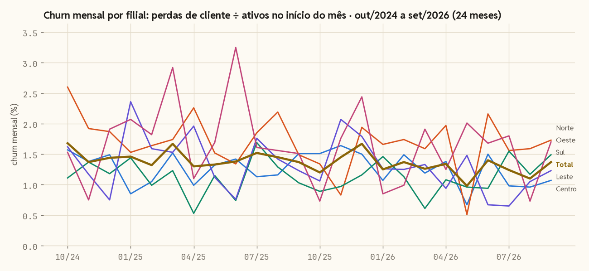
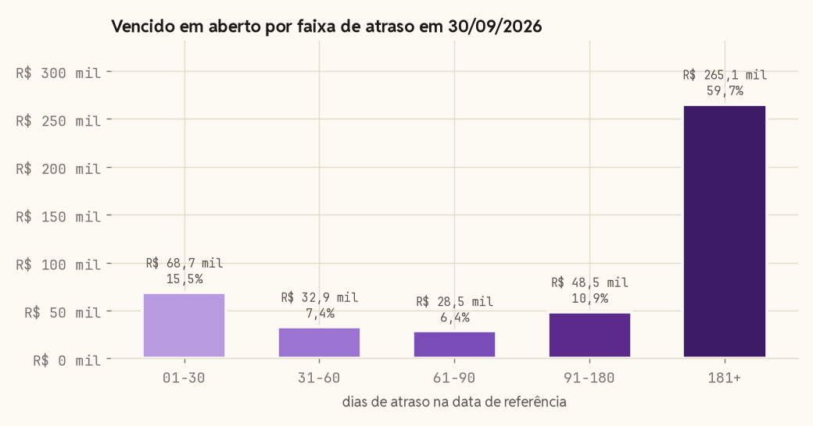
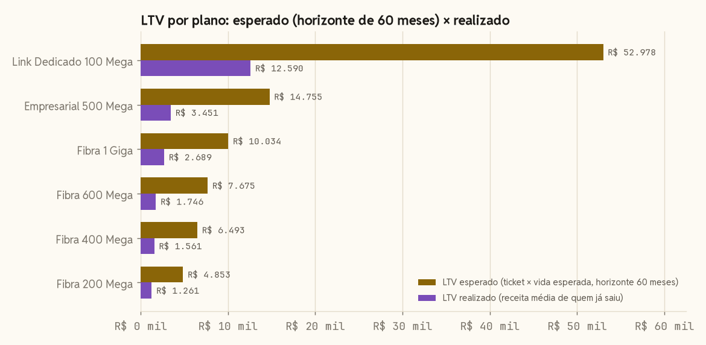
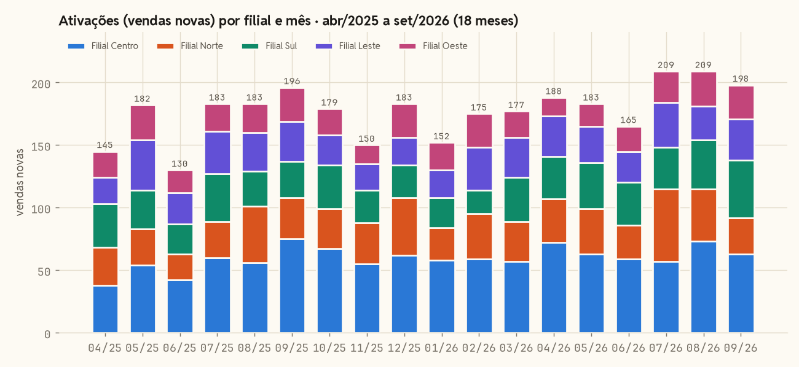
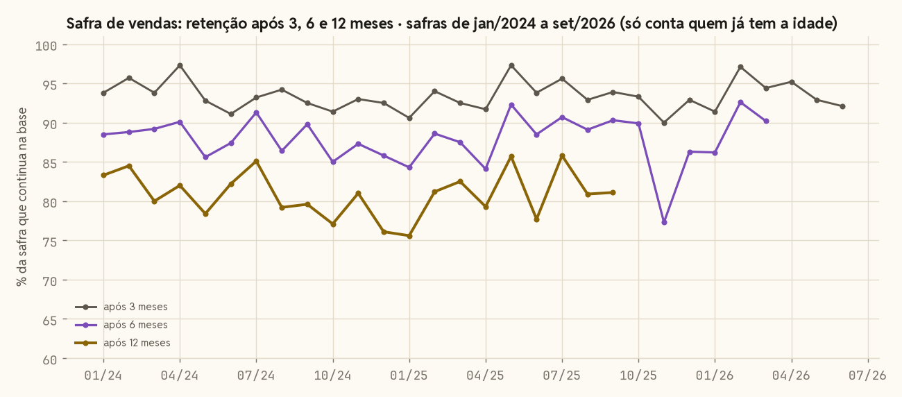

# Resultados
> Gerado por `python -m src.pipeline` em 28/10/2026 21:00 UTC · base fictícia (semente 42) · data de referência **30/09/2026** · 7.920 clientes · 9.000 contratos · 186.726 faturas · 18.627 ordens de serviço

Cada bloco é a saída de um arquivo de `sql/metricas/`. Os números abaixo são os mesmos que as portas de qualidade conferiram no fim da carga; as frases de leitura também são calculadas dos dados, a cada execução.

**Índice:** [Churn mensal por filial](#churn-mensal-por-filial) · [Inadimplência por faixa de atraso](#inadimplência-por-faixa-de-atraso) · [Inadimplência por filial](#inadimplência-por-filial) · [LTV por plano](#ltv-por-plano) · [Ativações por filial](#ativações-por-filial) · [Safra de vendas: retenção](#safra-de-vendas-retenção) · [Ordens de serviço: tempo de fechamento](#ordens-de-serviço-tempo-de-fechamento)

## Churn mensal por filial

`sql/metricas/churn.sql` · gráfico: últimos 24 meses · tabela: últimos 12 meses

<picture>
  <source media="(prefers-color-scheme: dark)" srcset="imagens/churn_mensal-escuro.png">
  
</picture>

Churn consolidado de **1,30% ao mês** nos últimos 12 meses (out/2025 a set/2026), cerca de 15% ao ano, com a base ativa indo de 4.678 para 6.195 contratos. Filial Norte tem o maior churn médio do período (1,56%) e Filial Sul o menor (1,13%).

Tabela completa (72 linhas)

| mes | filial | ativos_inicio | perdas | churn_pct | media_movel_3m |
|---|---|---|---|---|---|
| 2025-10 | TOTAL | 4678 | 56 | 1,2 | 1,34 |
| 2025-10 | Filial Centro | 1654 | 25 | 1,51 | 1,39 |
| 2025-10 | Filial Norte | 823 | 11 | 1,34 | 1,67 |
| 2025-10 | Filial Sul | 895 | 8 | 0,89 | 1,07 |
| 2025-10 | Filial Leste | 756 | 8 | 1,06 | 1,24 |
| 2025-10 | Filial Oeste | 550 | 4 | 0,73 | 1,27 |
| 2025-11 | TOTAL | 4818 | 70 | 1,45 | 1,34 |
| 2025-11 | Filial Centro | 1704 | 28 | 1,64 | 1,55 |
| 2025-11 | Filial Norte | 847 | 7 | 0,83 | 1,22 |
| 2025-11 | Filial Sul | 926 | 9 | 0,97 | 0,96 |
| 2025-11 | Filial Leste | 774 | 16 | 2,07 | 1,45 |
| 2025-11 | Filial Oeste | 567 | 10 | 1,76 | 1,33 |
| 2025-12 | TOTAL | 4907 | 82 | 1,67 | 1,44 |
| 2025-12 | Filial Centro | 1731 | 26 | 1,5 | 1,55 |
| 2025-12 | Filial Norte | 875 | 17 | 1,94 | 1,37 |
| 2025-12 | Filial Sul | 946 | 11 | 1,16 | 1,01 |
| 2025-12 | Filial Leste | 782 | 14 | 1,79 | 1,64 |
| 2025-12 | Filial Oeste | 573 | 14 | 2,44 | 1,64 |
| 2026-01 | TOTAL | 5020 | 63 | 1,25 | 1,46 |
| 2026-01 | Filial Centro | 1774 | 19 | 1,07 | 1,4 |
| 2026-01 | Filial Norte | 906 | 15 | 1,66 | 1,48 |
| 2026-01 | Filial Sul | 962 | 14 | 1,46 | 1,2 |
| 2026-01 | Filial Leste | 791 | 10 | 1,26 | 1,71 |
| 2026-01 | Filial Oeste | 587 | 5 | 0,85 | 1,68 |
| 2026-02 | TOTAL | 5118 | 70 | 1,37 | 1,43 |
| 2026-02 | Filial Centro | 1814 | 27 | 1,49 | 1,35 |
| 2026-02 | Filial Norte | 922 | 16 | 1,74 | 1,78 |
| 2026-02 | Filial Sul | 975 | 11 | 1,13 | 1,25 |
| 2026-02 | Filial Leste | 802 | 10 | 1,25 | 1,43 |
| 2026-02 | Filial Oeste | 605 | 6 | 0,99 | 1,43 |
| 2026-03 | TOTAL | 5241 | 66 | 1,26 | 1,29 |
| 2026-03 | Filial Centro | 1853 | 22 | 1,19 | 1,25 |
| 2026-03 | Filial Norte | 944 | 15 | 1,59 | 1,66 |
| 2026-03 | Filial Sul | 986 | 6 | 0,61 | 1,07 |
| 2026-03 | Filial Leste | 830 | 11 | 1,33 | 1,28 |
| 2026-03 | Filial Oeste | 628 | 12 | 1,91 | 1,25 |
| 2026-04 | TOTAL | 5362 | 72 | 1,34 | 1,32 |
| 2026-04 | Filial Centro | 1890 | 26 | 1,38 | 1,35 |
| 2026-04 | Filial Norte | 965 | 19 | 1,97 | 1,77 |
| 2026-04 | Filial Sul | 1014 | 11 | 1,08 | 0,94 |
| 2026-04 | Filial Leste | 853 | 8 | 0,94 | 1,17 |
| 2026-04 | Filial Oeste | 640 | 8 | 1,25 | 1,38 |
| 2026-05 | TOTAL | 5493 | 54 | 0,98 | 1,19 |
| 2026-05 | Filial Centro | 1943 | 13 | 0,67 | 1,08 |
| 2026-05 | Filial Norte | 984 | 5 | 0,51 | 1,36 |
| 2026-05 | Filial Sul | 1041 | 10 | 0,96 | 0,88 |
| 2026-05 | Filial Leste | 877 | 13 | 1,48 | 1,25 |
| 2026-05 | Filial Oeste | 648 | 13 | 2,01 | 1,72 |
| 2026-06 | TOTAL | 5638 | 79 | 1,4 | 1,24 |
| 2026-06 | Filial Centro | 2000 | 30 | 1,5 | 1,18 |
| 2026-06 | Filial Norte | 1017 | 22 | 2,16 | 1,55 |
| 2026-06 | Filial Sul | 1069 | 10 | 0,94 | 0,99 |
| 2026-06 | Filial Leste | 896 | 6 | 0,67 | 1,03 |
| 2026-06 | Filial Oeste | 656 | 11 | 1,68 | 1,65 |
| 2026-07 | TOTAL | 5740 | 71 | 1,24 | 1,21 |
| 2026-07 | Filial Centro | 2038 | 20 | 0,98 | 1,05 |
| 2026-07 | Filial Norte | 1025 | 16 | 1,56 | 1,41 |
| 2026-07 | Filial Sul | 1094 | 17 | 1,55 | 1,15 |
| 2026-07 | Filial Leste | 918 | 6 | 0,65 | 0,93 |
| 2026-07 | Filial Oeste | 665 | 12 | 1,8 | 1,83 |
| 2026-08 | TOTAL | 5904 | 65 | 1,1 | 1,25 |
| 2026-08 | Filial Centro | 2085 | 20 | 0,96 | 1,15 |
| 2026-08 | Filial Norte | 1071 | 17 | 1,59 | 1,77 |
| 2026-08 | Filial Sul | 1114 | 13 | 1,17 | 1,22 |
| 2026-08 | Filial Leste | 953 | 10 | 1,05 | 0,79 |
| 2026-08 | Filial Oeste | 681 | 5 | 0,73 | 1,4 |
| 2026-09 | TOTAL | 6061 | 83 | 1,37 | 1,24 |
| 2026-09 | Filial Centro | 2145 | 23 | 1,07 | 1 |
| 2026-09 | Filial Norte | 1096 | 19 | 1,73 | 1,63 |
| 2026-09 | Filial Sul | 1142 | 17 | 1,49 | 1,4 |
| 2026-09 | Filial Leste | 972 | 12 | 1,23 | 0,98 |
| 2026-09 | Filial Oeste | 706 | 12 | 1,7 | 1,41 |

## Inadimplência por faixa de atraso

`sql/metricas/inadimplencia_faixas.sql` · posição em 30/09/2026

<picture>
  <source media="(prefers-color-scheme: dark)" srcset="imagens/inadimplencia_faixas-escuro.png">
  
</picture>

**R$ 443.842** vencidos em aberto em 30/09/2026, em 1.776 contratos distintos. 59,7% do valor tem mais de 180 dias, e 63,3% do vencido está em contratos já cancelados: é dívida de quem saiu, não de quem está na base.

| ordem | faixa_dias | titulos | contratos | valor_vencido | pct_do_vencido |
|---|---|---|---|---|---|
| 1 | 01-30 | 446 | 446 | 68.746,23 | 15,5 |
| 2 | 31-60 | 217 | 217 | 32.911,6 | 7,4 |
| 3 | 61-90 | 179 | 179 | 28.543,41 | 6,4 |
| 4 | 91-180 | 359 | 290 | 48.508,64 | 10,9 |
| 5 | 181+ | 2113 | 860 | 265.131,75 | 59,7 |
| 9 | TOTAL | 3314 | 1992 | 443.841,63 | 100 |

> **Nota:** a linha TOTAL soma a coluna `contratos` das faixas (1.992); um contrato com títulos em mais de uma faixa conta em cada uma. Contratos distintos com vencido: 1.776. Corrigir o TOTAL no SQL para contar distintos, com teste, é o próximo passo (fora desta versão, que é só de apresentação).

## Inadimplência por filial

`sql/metricas/inadimplencia_filial.sql` · contratos ativos em 30/09/2026

Entre os contratos **ativos**, 941 de 6.195 (15,2%) têm algum título vencido. Filial Centro tem a maior taxa (15,9%) e Filial Oeste a menor (14,1%).

| filial | contratos_ativos | contratos_vencidos | taxa_inadimplencia_pct | valor_vencido | valor_acima_90d | posicao |
|---|---|---|---|---|---|---|
| Filial Centro | 2192 | 348 | 15,9 | 60.055,28 | 19.103,32 | 1 |
| Filial Sul | 1173 | 180 | 15,3 | 33.189,49 | 9.229,51 | 2 |
| Filial Leste | 995 | 152 | 15,3 | 25.420,87 | 9.839,53 | 3 |
| Filial Norte | 1114 | 159 | 14,3 | 25.691,02 | 6.377,99 | 4 |
| Filial Oeste | 721 | 102 | 14,1 | 18.415,89 | 6.130,63 | 5 |

## LTV por plano

`sql/metricas/ltv.sql` · ticket e churn dos últimos 12 meses; realizado de todos os contratos encerrados

<picture>
  <source media="(prefers-color-scheme: dark)" srcset="imagens/ltv_plano-escuro.png">
  
</picture>

O LTV esperado com horizonte de 60 meses vai de **R$ 4.853** (Fibra 200 Mega) a **R$ 52.978** (Link Dedicado 100 Mega). Em cada plano o realizado fica entre 23% e 27% do esperado: o padrão se repete, porque o realizado só enxerga quem já saiu, com 14,6 meses de casa em média.

| plano | segmento | ticket_medio | churn_mensal_pct | vida_esperada_meses | ltv_esperado | ltv_esperado_60m | ltv_realizado | meses_de_casa_encerrados | contratos_encerrados | posicao |
|---|---|---|---|---|---|---|---|---|---|---|
| Link Dedicado 100 Mega | PJ | 882,96 | 0,27 | 374,5 | 330.668,26 | 52.977,56 | 12.589,6 | 14 | 30 | 1 |
| Empresarial 500 Mega | PJ | 245,92 | 0,8 | 125,3 | 30.803,2 | 14.755,4 | 3.451 | 14,2 | 147 | 2 |
| Fibra 1 Giga | PF | 167,24 | 1,09 | 91,6 | 15.315,86 | 10.034,16 | 2.689,43 | 16,2 | 190 | 3 |
| Fibra 600 Mega | PF | 127,91 | 1,02 | 98,5 | 12.593,09 | 7.674,75 | 1.745,94 | 13,9 | 423 | 4 |
| Fibra 400 Mega | PF | 108,22 | 1,36 | 73,5 | 7.951,25 | 6.492,97 | 1.561,01 | 14,8 | 738 | 5 |
| Fibra 200 Mega | PF | 88,58 | 1,83 | 54,8 | 4.852,51 | 4.852,51 | 1.261,07 | 14,5 | 901 | 6 |

## Ativações por filial

`sql/metricas/ativacoes_filial.sql` · gráfico: últimos 18 meses · tabela: últimos 12 meses

<picture>
  <source media="(prefers-color-scheme: dark)" srcset="imagens/ativacoes_filial-escuro.png">
  
</picture>

**2.168 vendas novas** nos últimos 12 meses da tabela (3.187 nos 18 meses do gráfico; 5.200 na série inteira). Filial Centro lidera com 745 no ano, 34% do total.

| filial | ativacoes_12m | media_mensal | ultimo_mes | var_vs_mes_anterior_pct | var_vs_ano_anterior_pct | fatia_no_ultimo_mes_pct | posicao |
|---|---|---|---|---|---|---|---|
| Filial Centro | 745 | 62,1 | 63 | -13,7 | -16 | 31,8 | 1 |
| Filial Norte | 432 | 36 | 29 | -31 | -12,1 | 14,6 | 2 |
| Filial Sul | 388 | 32,3 | 46 | 17,9 | 58,6 | 23,2 | 3 |
| Filial Leste | 337 | 28,1 | 33 | 22,2 | 3,1 | 16,7 | 4 |
| Filial Oeste | 266 | 22,2 | 27 | -3,6 | 0 | 13,6 | 5 |

## Safra de vendas: retenção

`sql/metricas/safra.sql` · todas as safras da série; cada coluna só conta quem já tem a idade

<picture>
  <source media="(prefers-color-scheme: dark)" srcset="imagens/safra_retencao-escuro.png">
  
</picture>

Em média, **93%** de cada safra de vendas continua na base após 3 meses, 88% após 6 e 81% após 12 (a retenção de 12 meses só conta as 21 safras que já têm essa idade).

Tabela completa (33 linhas)

| safra | vendas | ja_cancelaram | cancelados_pct | retencao_3m_pct | retencao_6m_pct | retencao_12m_pct |
|---|---|---|---|---|---|---|
| 2024-01 | 96 | 28 | 29,2 | 93,8 | 88,5 | 83,3 |
| 2024-02 | 116 | 29 | 25 | 95,7 | 88,8 | 84,5 |
| 2024-03 | 130 | 35 | 26,9 | 93,8 | 89,2 | 80 |
| 2024-04 | 111 | 35 | 31,5 | 97,3 | 90,1 | 82 |
| 2024-05 | 111 | 37 | 33,3 | 92,8 | 85,6 | 78,4 |
| 2024-06 | 135 | 37 | 27,4 | 91,1 | 87,4 | 82,2 |
| 2024-07 | 161 | 42 | 26,1 | 93,2 | 91,3 | 85,1 |
| 2024-08 | 154 | 48 | 31,2 | 94,2 | 86,4 | 79,2 |
| 2024-09 | 147 | 46 | 31,3 | 92,5 | 89,8 | 79,6 |
| 2024-10 | 140 | 46 | 32,9 | 91,4 | 85 | 77,1 |
| 2024-11 | 142 | 38 | 26,8 | 93 | 87,3 | 81 |
| 2024-12 | 134 | 45 | 33,6 | 92,5 | 85,8 | 76,1 |
| 2025-01 | 127 | 39 | 30,7 | 90,6 | 84,3 | 75,6 |
| 2025-02 | 149 | 35 | 23,5 | 94 | 88,6 | 81,2 |
| 2025-03 | 160 | 38 | 23,8 | 92,5 | 87,5 | 82,5 |
| 2025-04 | 145 | 34 | 23,4 | 91,7 | 84,1 | 79,3 |
| 2025-05 | 182 | 33 | 18,1 | 97,3 | 92,3 | 85,7 |
| 2025-06 | 130 | 31 | 23,8 | 93,8 | 88,5 | 77,7 |
| 2025-07 | 183 | 30 | 16,4 | 95,6 | 90,7 | 85,8 |
| 2025-08 | 183 | 40 | 21,9 | 92,9 | 89,1 | 80,9 |
| 2025-09 | 196 | 38 | 19,4 | 93,9 | 90,3 | 81,1 |
| 2025-10 | 179 | 28 | 15,6 | 93,3 | 89,9 | — |
| 2025-11 | 150 | 36 | 24 | 90 | 77,3 | — |
| 2025-12 | 183 | 35 | 19,1 | 92,9 | 86,3 | — |
| 2026-01 | 152 | 28 | 18,4 | 91,4 | 86,2 | — |
| 2026-02 | 175 | 14 | 8 | 97,1 | 92,6 | — |
| 2026-03 | 177 | 18 | 10,2 | 94,4 | 90,2 | — |
| 2026-04 | 188 | 15 | 8 | 95,2 | — | — |
| 2026-05 | 183 | 19 | 10,4 | 92,9 | — | — |
| 2026-06 | 165 | 16 | 9,7 | 92,1 | — | — |
| 2026-07 | 209 | 11 | 5,3 | — | — | — |
| 2026-08 | 209 | 3 | 1,4 | — | — | — |
| 2026-09 | 198 | 0 | 0 | — | — | — |

## Ordens de serviço: tempo de fechamento

`sql/metricas/os_tempo_fechamento.sql` · abertas nos últimos 12 meses

Nos últimos 12 meses, 6.101 ordens de serviço foram fechadas e 33 seguem abertas. Reparo leva 1,0 dia na mediana (1,6 na média): a mediana é a que vale, porque poucas O.S. longas puxam a média.

| assunto | fechadas | abertas | media_dias | mediana_dias | maximo_dias |
|---|---|---|---|---|---|
| INSTALACAO | 2600 | 0 | 4 | 4 | 7 |
| REPARO | 2266 | 29 | 1,6 | 1 | 23 |
| CANCELAMENTO | 967 | 0 | 2,4 | 2 | 5 |
| MUDANCA DE ENDERECO | 268 | 4 | 1,5 | 1 | 11 |

## Execução registrada

Etapas da última execução do pipeline (`controle_execucao`).

| etapa | situacao | duracao_s |
|---|---|---|
| carregar_sor | OK | 6,17 |
| construir_sot | OK | 2,34 |
| construir_spec | OK | 0,36 |
| portas | OK | 0,05 |
